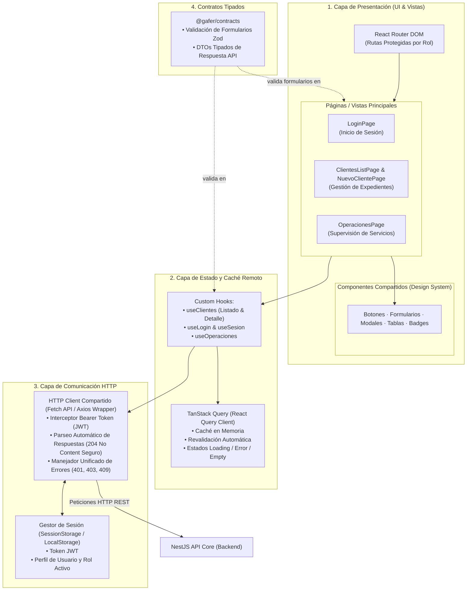
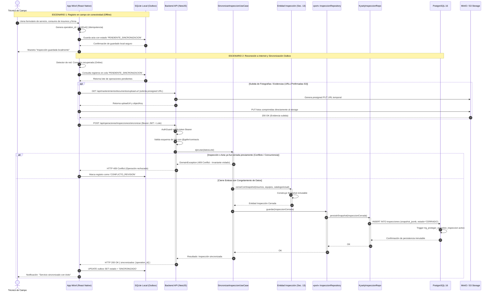
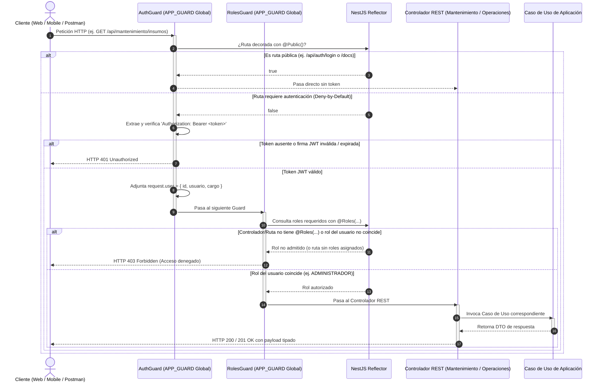

# Catálogo Oficial de Diagramas de Arquitectura — GAFER v1
**Proyecto:** Sistema de Gestión de Operaciones de Campo y Certificación Ambiental  
**Curso:** Prácticas Preprofesionales (Fase 1 / Hito 1)  
**Fuente de verdad técnica:** Monorepo GAFER (`apps/api`, `apps/web`, `apps/mobile`, `packages/contracts`)  

> [!NOTE]  
> **Modelo Entidad-Relación (DER) de Base de Datos:**  
> El modelo físico y relacional de PostgreSQL 16 (tablas, claves foráneas `ON DELETE RESTRICT`, tipos enum y triggers de inmutabilidad) se gestiona de manera centralizada en [dbdiagram.io](https://dbdiagram.io) y se versiona en las migraciones SQL del repositorio (`infra/migrations/001_initial_schema.up.sql` y `002_personal_clave_hash.up.sql`). No se duplica en este catálogo para evitar desincronizaciones de esquema.

---

## Índice de Diagramas
1. [Diagrama 1: Arquitectura General del Sistema (Nivel 0 — Visión Macro)](#diagrama-1-arquitectura-general-del-sistema-nivel-0)
2. [Diagrama 2: Backend — Arquitectura Hexagonal y Puertos/Adaptadores (Nivel 1)](#diagrama-2-backend--arquitectura-hexagonal-y-puertosadaptadores-nivel-1)
3. [Diagrama 3: Frontend Web — Arquitectura de Capas y Flujo de Datos](#diagrama-3-frontend-web--arquitectura-de-capas-y-flujo-de-datos)
4. [Diagrama 4: Flujo de Sincronización Offline y Resiliencia de Campo](#diagrama-4-flujo-de-sincronización-offline-y-resiliencia-de-campo)
5. [Diagrama 5: Flujo de Seguridad y Autorización (Deny-by-Default)](#diagrama-5-flujo-de-seguridad-y-autorización-deny-by-default)

---

## Diagrama 1: Arquitectura General del Sistema (Nivel 0)

### Propósito
Proporcionar una vista ejecutiva de alto nivel que responda rápidamente: *¿cuáles son las grandes partes del sistema y cómo se comunican?* Ideal para el informe ejecutivo, la portada de entregables y la introducción ante el Product Owner (PO).

```mermaid
flowchart TB
    %% ============================================================
    %% 1. CLIENTES EXTERNOS
    %% ============================================================
    subgraph CLIENTS ["1. Clientes y Entradas Externas"]
        WEB["Web App (Backoffice Administrativo)\nReact 18 + Vite"]
        MOBILE["Mobile App (Operaciones en Campo)\nReact Native + Offline Outbox"]
        CLI["Admin CLI (Herramienta de Bootstrap)\npnpm db:crear-usuario"]
    end

    %% ============================================================
    %% CONTRATOS COMPARTIDOS
    %% ============================================================
    subgraph CONTRACTS_PKG ["Single Source of Truth"]
        CONTRACTS["@gafer/contracts\nContratos compartidos (Zod + DTOs)"]
    end

    %% ============================================================
    %% 2. API / ADAPTADORES DE ENTRADA
    %% ============================================================
    subgraph API ["2. API / Adaptadores de Entrada"]
        SECURITY["Seguridad y Control de Acceso\nAPP_GUARD (AuthGuard + RolesGuard)"]
        REST["API REST (NestJS Core)\nControladores y Filtros de Excepción"]
    end

    %% ============================================================
    %% 3. CAPA DE APLICACIÓN
    %% ============================================================
    subgraph APPLICATION ["3. Capa de Aplicación"]
        USE_CASES["Casos de Uso de Negocio\n• Autenticación y Credenciales\n• Catálogos Maestros de Saneamiento\n• Configuración y Gobernanza\n• Operaciones e Inmutabilidad de Campo"]
    end

    %% ============================================================
    %% 4. NÚCLEO DE DOMINIO
    %% ============================================================
    subgraph DOMAIN ["4. Núcleo de Dominio"]
        BUSINESS["Entidades y Reglas de Dominio Puro\n(Sin dependencias de frameworks)"]
        PORTS["Puertos de Salida (Interfaces TypeScript)\nRepositorios · Storage · Auditoría"]
    end

    %% ============================================================
    %% 5. ADAPTADORES DE SALIDA
    %% ============================================================
    subgraph ADAPTERS ["5. Adaptadores de Salida"]
        DB_ADAPTER["Persistencia Relacional\nAdaptadores Kysely"]
        STORAGE_ADAPTER["Object Storage\nAdaptador MinIO / S3 SDK"]
    end

    %% ============================================================
    %% 6. RECURSOS EXTERNOS
    %% ============================================================
    subgraph INFRA ["6. Recursos de Persistencia"]
        DB[("PostgreSQL 16\nMotor Relacional")]
        STORAGE[("MinIO S3 / Cloudflare R2\nAlmacenamiento de Archivos")]
    end

    %% ============================================================
    %% RELACIONES
    %% ============================================================
    WEB -->|HTTPS REST + Bearer Token| SECURITY
    MOBILE -->|HTTPS REST + Bearer Token| SECURITY
    CLI -.->|Bootstrap Inicial (Admin)| DB

    SECURITY -->|Autoriza acceso| REST
    REST -->|Invoca| USE_CASES

    USE_CASES -->|Aplica reglas sobre| BUSINESS
    USE_CASES -->|Invoca| PORTS

    DB_ADAPTER -.->|implementa| PORTS
    STORAGE_ADAPTER -.->|implementa| PORTS

    DB_ADAPTER -->|SQL Type-Safe| DB
    STORAGE_ADAPTER -->|S3 Protocol| STORAGE

    CONTRACTS -.->|contratos compartidos| WEB
    CONTRACTS -.->|contratos compartidos| MOBILE
    CONTRACTS -.->|contratos compartidos| REST
```

---

## Diagrama 2: Backend — Arquitectura Hexagonal y Puertos/Adaptadores (Nivel 1)

### Propósito
Detallar la estructura interna del backend (`apps/api`). Demuestra la aplicación estricta del principio de Inversión de Dependencias (DIP), la separación de capas limpias y la organización de los 4 pilares de casos de uso y puertos del Hito 1.

```mermaid
flowchart TB
    %% =============================================================
    %% PAQUETE COMPARTIDO TRANSVERSAL
    %% =============================================================
    subgraph SHARED ["Paquete Compartido (Single Source of Truth)"]
        CONTRACTS["@gafer/contracts\n• Esquemas Zod & DTOs de Transporte\n• Tipos de Autenticación y Roles"]
    end

    %% =============================================================
    %% 1. CLIENTES Y ACTORES
    %% =============================================================
    subgraph CLIENTES ["1. Clientes y Adaptadores Externos"]
        WEB["Frontend Web (React 18 / Vite)\nBackoffice Administrativo"]
        MOB["App Móvil Android (React Native)\nOperaciones en Campo (Outbox Offline)"]
        CLI["CLI de Administración (Node.js)\npnpm db:crear-usuario"]
    end

    %% =============================================================
    %% 2. INFRAESTRUCTURA DE ENTRADA (DRIVING ADAPTERS)
    %% =============================================================
    subgraph INFRA_IN ["2. Adaptadores de Entrada (NestJS HTTP)"]
        direction TB
        subgraph CROSS_CUTTING ["Componentes Transversales"]
            AUTH_GUARD["APP_GUARD Global (Deny-by-Default)\nAuthGuard (JWT) + RolesGuard"]
            FILTER["DomainExceptionFilter (HTTP 400 / 404 / 409)"]
        end

        DOCS["Documentación OpenAPI / Scalar (/docs)"]

        subgraph CONTROLLERS ["Controladores REST"]
            C_AUTH["AuthController (/api/auth)"]
            C_MANT["MantenimientoController (/api/mantenimiento)"]
            C_OPER["OperacionesController (/api/operaciones)"]
        end
    end

    %% =============================================================
    %% 3. CAPA DE APLICACIÓN (CASOS DE USO)
    %% =============================================================
    subgraph APP ["3. Capa de Aplicación (Casos de Uso)"]
        direction TB
        UC_AUTH["Casos de Uso de Autenticación\n(Login, scrypt + salt)"]
        UC_MAESTROS["Casos de Uso de Catálogos Maestros\n(Clientes, Sedes, Insumos, Equipos, Personal)"]
        UC_CONF["Casos de Uso de Configuración\n(Catálogos de Texto, Parámetros, Auditoría)"]
        UC_OPS["Casos de Uso de Operaciones\n(Sincronización, Congelamiento de Snapshot)"]
    end

    %% =============================================================
    %% 4. NÚCLEO DE DOMINIO (DOMAIN CORE)
    %% =============================================================
    subgraph DOMAIN ["4. Núcleo de Dominio (Domain Core)"]
        direction TB
        subgraph ENTITIES ["Entidades y Reglas de Negocio"]
            E_MAESTRAS["Entidades Maestras:\nCliente, Proyecto, Insumo, Equipo, Personal"]
            E_SISTEMA["Entidades de Configuración:\nCatalogoTexto, ConfiguracionSistema"]
            E_INSP["Entidad Inspección:\nInvariante de Inmutabilidad de Acta Cerrada"]
        end

        subgraph PORTS ["Puertos de Salida (Interfaces)"]
            P_MAESTROS["«interface» Repositorios Maestros\n(ClienteRepo, InsumoRepo, EquipoRepo, PersonalRepo)"]
            P_CONF["«interface» Repositorios de Sistema\n(ConfiguracionRepo, AuditoriaRepo)"]
            P_SEC["«interface» UsuarioRepository"]
            P_INSP["«interface» InspeccionRepository"]
            P_STORAGE["«interface» StoragePort (Archivos)"]
        end
    end

    %% =============================================================
    %% 5. INFRAESTRUCTURA DE SALIDA (DRIVEN ADAPTERS)
    %% =============================================================
    subgraph INFRA_OUT ["5. Adaptadores de Salida (Driven Adapters)"]
        direction TB
        ADAPT_MAESTROS["Adaptadores Kysely Maestros\n(Pool de Conexiones PostgreSQL)"]
        ADAPT_CONF["Adaptadores Kysely de Sistema"]
        ADAPT_SEC["KyselyUsuarioRepository"]
        ADAPT_INSP["KyselyInspeccionRepo"]
        ADAPT_STORAGE["MinioS3StorageAdapter\n(Cliente S3 SDK / URLs Prefirmadas)"]
    end

    %% =============================================================
    %% 6. PERSISTENCIA FÍSICA
    %% =============================================================
    subgraph STORAGE ["6. Persistencia Física y Recursos"]
        PG[("PostgreSQL 16\n• Tablas Relacionales (FK Restrictivas)\n• Snapshots JSONB\n• Triggers de Motor para Inmutabilidad")]
        S3[("Object Storage (MinIO / S3)\n• Bucket: Fichas Técnicas, MSDS y Fotos")]
    end

    %% =============================================================
    %% RELACIONES Y FLUJO DE DATOS
    %% =============================================================
    CONTRACTS -.->|contratos compartidos| WEB
    CONTRACTS -.->|contratos compartidos| MOB
    CONTRACTS -.->|contratos compartidos| CONTROLLERS

    WEB -->|HTTP REST + Bearer Token| AUTH_GUARD
    MOB -->|HTTP REST + Bearer Token| AUTH_GUARD
    CLI -.->|Bootstrap Inicial (Admin)| PG

    AUTH_GUARD -->|autoriza acceso a| CONTROLLERS
    DOCS -.->|documenta endpoints de| CONTROLLERS

    C_AUTH --> UC_AUTH
    C_MANT --> UC_MAESTROS
    C_MANT --> UC_CONF
    C_OPER --> UC_OPS

    UC_AUTH --> P_SEC
    UC_MAESTROS --> P_MAESTROS
    UC_MAESTROS -->|aplica reglas de| E_MAESTRAS
    UC_CONF --> P_CONF
    UC_CONF -->|aplica reglas de| E_SISTEMA
    UC_OPS --> P_INSP
    UC_OPS --> P_STORAGE
    UC_OPS -->|aplica reglas de| E_INSP

    ADAPT_MAESTROS -.->|implementa| P_MAESTROS
    ADAPT_CONF -.->|implementa| P_CONF
    ADAPT_SEC -.->|implementa| P_SEC
    ADAPT_INSP -.->|implementa| P_INSP
    ADAPT_STORAGE -.->|implementa| P_STORAGE

    ADAPT_MAESTROS --> PG
    ADAPT_CONF --> PG
    ADAPT_SEC --> PG
    ADAPT_INSP --> PG
    ADAPT_STORAGE --> S3
```

---

## Diagrama 3: Frontend Web — Arquitectura de Capas y Flujo de Datos

### Propósito
Ilustrar la arquitectura de la aplicación web administrativa (`apps/web`), basada en React 18, Vite y TanStack Query. Refleja cómo la interfaz consume la API mediante un cliente HTTP compartido gobernado por `@gafer/contracts`.



---

## Diagrama 4: Flujo Previsto de Sincronización Offline (Diseño Preparado para Hito 2)

### Propósito
Diagrama de secuencia que describe el flujo arquitectónico diseñado y preparado en el backend para la sincronización de la app móvil en campo (Fase 1 / Hito 2). Ilustra cómo se registran actas sin señal utilizando el patrón Outbox local, y cómo la arquitectura hexagonal del backend orquesta el guardado respetando la inmutabilidad (Sección 13), la inversión de dependencias y el almacenamiento de evidencias.



---

## Diagrama 5: Flujo de Seguridad y Autorización (Deny-by-Default)

### Propósito
Mostrar el flujo de ejecución de la seguridad global introducida en el PR #16 (GAF-93), explicando cómo toda ruta de la API está cerrada por defecto y requiere token y rol explícito para ejecutarse.


